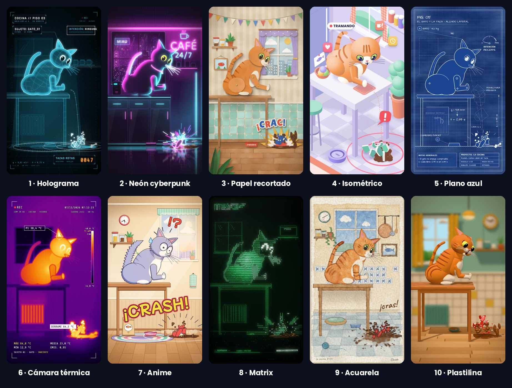
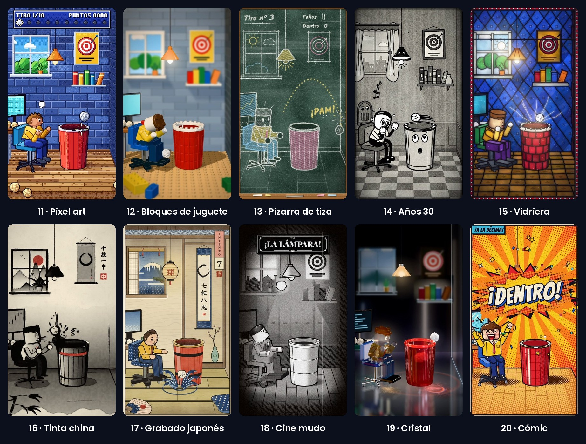

# 20 estilos de animación para Claude Code

**Dos escenas, pintadas de 20 maneras, con el código exacto de cada estilo.** Un gato mira la taza, te mira, la empuja… y la
taza cae. Un muñeco de bloques lanza una bola de papel a la papelera: falla 9 veces y la décima entra. Le pides un estilo a Claude
y te sale igual que en el vídeo; le cuentas tu escena y te la pinta con esa misma piel.



- **Gratis** y de código abierto (MIT).
- **Corre en tu computadora**, con Claude Code. Mac, Windows y Linux.
- Vídeo vertical de 1080 × 1920 (o en 4K), listo para Reels, TikTok y Shorts.

Hecho por **Kevin Remón** · Instagram [@kevin.rf99](https://www.instagram.com/kevin.rf99/)

---

## Instalarlo (una vez)

1. Abre **Claude** en tu computadora, en la pestaña **Code** (en la pestaña Chat no funciona). Te vale cualquier carpeta.
2. Pégale esto:
   ```
   Instala las animaciones de github.com/remonkevin99-collab/animaciones en mi carpeta de skills, con todo lo que necesiten para funcionar
   ```
3. **Claude te irá pidiendo permiso** para descargar e instalar lo que hace falta: dale a Permitir. Solo pasa la primera vez.
4. Cuando te diga que terminó, cierra Claude y vuelve a abrirlo.

## Usarlo

**El gato o la bola de papel, en el estilo que quieras** (sale igual que en el vídeo, sin gastar casi nada):
```
/animaciones plano azul
```
```
/animaciones cine mudo
```

**Tu escena, en ese estilo:**
```
/animaciones neón: mi perro roba un calcetín del cesto y sale corriendo
```
```
/animaciones plastilina: mi taza de café gira sobre la mesa y sale el logo de mi cafetería
```

Claude lee la piel del estilo (los colores, el papel, el trazo, las letras y cómo cuenta el golpe), la copia tal cual y dibuja
tus cosas con ella. Te enseña una foto primero y después el vídeo.

**Casi nunca sale perfecto a la primera:** míralo y pídele retoques con palabras normales («más lento», «el perro más grande»,
«más brillo») hasta que te guste. Lo sencillo (un producto, un móvil, un logo, un gráfico) sale antes que un personaje que se
mueve mucho.

## Parte 1 · El gato

| | Estilo | Escribe | Cómo es |
|---|---|---|---|
| 1 | Holograma | `holograma` | Alambre de luz cian sobre negro, con rótulos de ciencia ficción y el contador que se fija en naranja |
| 2 | Neón cyberpunk | `neon` | Una cocina de noche con lluvia y ciudad detrás: tubos rosa y cian, y el suelo mojado que lo refleja todo |
| 3 | Papel recortado | `papel` | Cartulina cortada a tijera, con su fibra y sus sombras, animada a saltitos como el stop motion |
| 4 | Isométrico | `isometrico` | Una maqueta en pastel vista a 45°, con tarjetitas que flotan |
| 5 | Plano azul | `plano-azul` | El plano de un ingeniero: líneas blancas, cotas que miden en vivo y un sello rojo |
| 6 | Cámara térmica | `termica` | Todo pintado como calor, con el visor, la mira y la temperatura en vivo |
| 7 | Anime | `anime` | Una serie japonesa de televisión: contornos finos, sombras de borde duro y un fotograma de impacto |
| 8 | Matrix | `matrix` | La escena hecha de letras verdes en una pantalla vieja |
| 9 | Acuarela | `acuarela` | Aguadas que se corren, lápiz suelto y papel con grano |
| 10 | Plastilina | `plastilina` | Plastilina en 3D con huellas de dedo, luz de estudio y stop motion |

## Parte 2 · La bola de papel

Un muñeco de bloques, en su silla de oficina, lanza una bola de papel a la papelera. Cada estilo enseña un lanzamiento distinto
(rebota en el borde, se queda corta, choca con la lámpara…) y el último entra. Puedes pedir cualquier lanzamiento en cualquier
estilo.



| | Estilo | Escribe | Cómo es |
|---|---|---|---|
| 11 | Pixel art | `pixel-art` | Un juego de consola de 16 bits, con su marcador, sus globos y el «¡FALLO!» de recreativa |
| 12 | Bloques de juguete | `bloques` | Piezas de juguete en 3D, como una foto macro de stop motion |
| 13 | Pizarra de tiza | `pizarra` | Todo se dibuja solo en tiza, con la trayectoria en puntos y las notas del profe |
| 14 | Años 30 | `anos-30` | Un dibujo animado en blanco y negro, con brazos de manguera y película vieja |
| 15 | Vidriera | `vidriera` | La escena hecha vidrio de colores y plomo, con el sol detrás |
| 16 | Tinta china | `tinta-china` | Pincel y aguada sobre papel de arroz, con su sello rojo |
| 17 | Grabado japonés | `grabado-japones` | Una estampa de madera de Edo, con el Fuji en la ventana y olas de espuma |
| 18 | Cine mudo | `cine-mudo` | Una comedia de los años 20: grano, rayas, rótulo y el iris que se cierra |
| 19 | Cristal | `cristal` | Todo de vidrio tallado en 3D, en un estudio negro con suelo de espejo |
| 20 | Cómic | `comic` | Una viñeta de tebeo con trama de puntos, onomatopeyas y el «¡DENTRO!» que estalla |

La piel de cada uno, explicada para Claude: `piel/`.

## Para Claude: cómo se instala

Haz esto en orden y dile a la persona cómo va.

1. **Copia el repositorio en la carpeta de skills de la persona**, con el nombre `animaciones`:
   - Mac y Linux: `git clone --depth 1 https://github.com/remonkevin99-collab/animaciones.git ~/.claude/skills/animaciones`
   - Windows (PowerShell): `git clone --depth 1 https://github.com/remonkevin99-collab/animaciones.git "$HOME\.claude\skills\animaciones"`
   - Sin git: baja https://github.com/remonkevin99-collab/animaciones/archive/refs/heads/main.zip, descomprímelo y deja la
     carpeta como `~/.claude/skills/animaciones` (que dentro esté `SKILL.md`, no otra carpeta).
   - Si ya existe, actualízala con `git pull` en vez de clonarla.
2. **Node.js 18 o más nuevo:** `node --version`. Si no está, instálalo (Mac: `brew install node` o el instalador LTS de
   https://nodejs.org; Windows: `winget install OpenJS.NodeJS.LTS`).
3. **Dentro de esa carpeta, `npm install`.** Para comprobarlo: `npx remotion compositions src/index.ts` tiene que listar los 20.
4. **Dile a la persona** que cierre Claude y lo vuelva a abrir: después ya puede escribir `/animaciones`.

Cómo se usa después está en `SKILL.md`.

## Sin Claude, desde la terminal

```
npm install
npx remotion studio src/index.ts                                   # verlos en vivo
npx remotion render src/index.ts plano-azul out/plano-azul.mp4     # sacar uno
npx remotion render src/index.ts plastilina out/plastilina.mp4 --scale=2   # en 4K
npx remotion render src/index.ts comic out/comic.mp4 --props='{"intento":3}'   # la bola, con otro lanzamiento (del 1 al 10)
```

## Licencias

- **El código**: MIT, de Kevin Remón (`LICENSE`).
- **Parte del código de la bola de papel** está adaptado de otro proyecto con licencia MIT: su aviso y la lista de archivos, en
  `AVISOS.md`.
- **Las letras** se cargan de Google Fonts al sacar el vídeo, cada una con su licencia abierta (SIL Open Font License). Dos van
  dentro del paquete, con su aviso en `AVISOS.md`.
